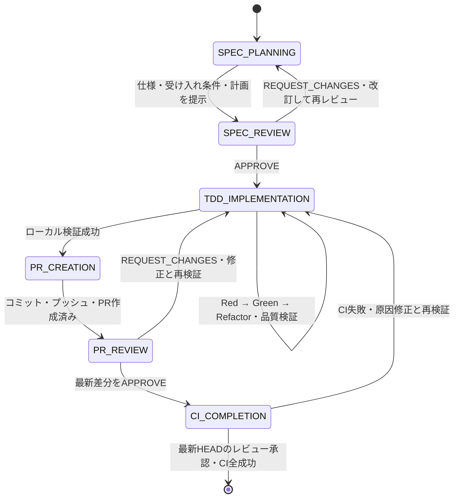

# タスク実行プロンプト

このリポジトリでは `prompt/PLAN.md` と `prompt/SPEC.md` を参照しながら、AIキャッシュ制御型ベクターDB「Pyrope」を実装します。
タスクは次の順序で完遂してください。**実装やPR作成だけで終了せず、独立したレビューでの承認と最新コミットのCIオールグリーンまで対応します。**

1. 仕様検討・実装計画の策定
2. サブエージェントによる仕様レビューと改善ループ
3. TDD実装・ローカル検証
4. コミット・プッシュ・PR作成
5. サブエージェントによるPRレビューと改善ループ
6. CIの監視・修正を継続し、全チェック成功を確認

ユーザーがドキュメント編集のみなど作業範囲を明示した場合は、その範囲を優先します。以下を実装タスクの標準フローとし、ユーザーが明示した範囲制限は優先します。

---

## プロジェクト構造

```text
Pyrope/
├── src/
│   ├── Pyrope.GarnetServer/       # C# Garnetサーバー（Fast Path）
│   ├── Pyrope.Benchmarks/         # ベンチマークCLI
│   ├── Pyrope.AISidecar/          # Python AIサイドカー（Warm Path / gRPC）
│   └── Protos/                   # gRPC Proto定義
├── tests/
│   ├── Pyrope.GarnetServer.Tests/ # C# xUnitテスト
│   └── smoke_test.py             # Redisクライアント smoke test
├── scripts/
│   ├── check_quality.sh          # ローカル品質チェック
│   ├── bench_vectors.sh          # ベンチマーク
│   └── generate_mtls_certs.sh     # mTLS証明書生成
├── prompt/
│   ├── PROMPT.md                 # 本ワークフロー
│   ├── PLAN.md                   # 実装ロードマップ・進捗
│   └── SPEC.md                   # 機能仕様
└── docker-compose.yml
```

## 6ステージ実装フロー



修正後は既存PRのブランチに追加コミットをプッシュし、同じPRを再レビューします。PRを重複作成しません。

### Stage 1: SPEC_PLANNING（仕様検討・実装計画）

- `AGENTS.md`、`prompt/PLAN.md`、`prompt/SPEC.md`、関連コード・テスト・Proto・CI定義を確認する。
- 文書を含む変更を始める前に作業ツリーとベースブランチを確認し、専用ブランチを作成する。既存の当該タスク用ブランチがあれば継続し、ユーザーの未コミット変更は保全する。
  ```bash
  git status --short --branch
  git switch -c feature/<トピック>
  ```
  新規ブランチは合意したベース（通常 `main`）から作成する。文書更新は `docs/<トピック>` など目的に合う名前でもよい。
- 目的、対象範囲、対象外、受け入れ条件、異常系・境界値、既存仕様との互換性を言語化する。
- RESP / HTTP / gRPCの契約、テナント分離、認証、入力検証、mTLS、性能・運用への影響を検討する。
- 変更対象、依存関係、段階的な実装手順、Redにするテスト、Unit / Integration / E2Eの検証方法を計画する。
- 計画は会話内またはプロジェクト既存の文書構成に記録する。仕様変更が必要なら、実装前に `prompt/SPEC.md` の変更案もレビュー対象に含める。
- `prompt/PLAN.md` に該当タスクがある場合は着手状況を更新する。ワークフロー文書だけの変更で、製品ロードマップに無関係なタスクを追加しない。
- 安全に解決できる事項は根拠を示して判断し、要件の矛盾などユーザーの決定が必要な事項だけ確認する。

**ゲート**: 仕様・受け入れ条件と実装・テスト計画が、第三者によってレビューできる状態になっていること。

### Stage 2: SPEC_REVIEW（サブエージェントによる仕様レビュー・改善）

- **執筆したメインエージェント自身で承認せず、独立したサブエージェントに必ずレビューを依頼する。**
- 実行環境で利用可能なサブエージェント起動ツールを使う。特定環境専用のAPI名や引数を前提にしない。
- レビュアーには計画全文・改訂番号、ユーザー要求、参照仕様、関連コード・テスト、レビュー観点を渡す。レビュアーは読み取り専用で評価する。
- 仕様の抜け・矛盾、受け入れ条件の明確さ、後方互換性、セキュリティ、実現可能性、テスト可能性、変更範囲の妥当性を確認させる。

```markdown
## Specification Review Result
- Target: <計画の改訂番号>
- Verdict: APPROVE | REQUEST_CHANGES
- Summary: <要約>
- Findings: <重要度・根拠・改善案。指摘なしの場合は「なし」>
```

**改善ループ**: `REQUEST_CHANGES` → 指摘ごとの対応を整理 → Stage 1で仕様・計画を改訂 → サブエージェントに再レビューを依頼。**改訂後の計画が `APPROVE` になるまで実装へ進まない。**

### Stage 3: TDD_IMPLEMENTATION（TDD実装・ローカル検証）

1. Stage 1で用意した専用ブランチ上で作業していることと、承認済みの仕様・計画を確認する。
2. **Red**: 受け入れ条件や不具合を再現するテストを先に追加し、期待した理由で失敗することを確認する。
3. **Green**: テストを成功させる最小限の実装を行う。
4. **Refactor**: 可読性・責務分離・重複を改善し、テスト成功を維持する。
5. 必要なUnit / Integration / E2Eを実行し、80%以上のカバレッジ要件を確認する。テストを弱めて成功扱いにしない。
6. Protoを変更した場合は次のコマンドで同期する。生成したgRPCスタブはコミットしない。
   ```bash
   (cd src/Pyrope.AISidecar && python3 codegen.py)
   ```
7. 関連ドキュメントと `prompt/PLAN.md` の該当進捗を実態に合わせ、ローカル品質チェックを実行する。
   ```bash
   ./scripts/check_quality.sh
   python3 -m unittest discover -s src/Pyrope.AISidecar/tests -p "test_*.py"
   ```
   フォーマット修正が必要な場合は対象範囲を確認して `dotnet format Pyrope.sln` を実行し、再検証する。
   `check_quality.sh` のPython lintは非ブロッキングで、Pythonテストは含まれないため、終了コード0だけで全検証成功と見なさない。CI定義に合わせたlint・formatチェックと、変更に必要なsmoke testも実行する。

文書のみで実行時の振る舞いが変わらない変更では、形式的なテスト追加は不要。差分・参照先・手順・状態遷移の整合性を検証し、TDDやカバレッジの非該当理由を記録する。リポジトリで必須の品質チェックは実行する。

**ゲート**: 承認仕様を満たし、必要な検証が成功していること。失敗したら原因を修正し、該当するRed → Greenと品質検証を繰り返す。仕様・設計を変える修正はStage 1〜2へ戻す。

### Stage 4: PR_CREATION（コミット・プッシュ・PR作成）

**Stage 5のPRレビューより先に、レビュー対象となる実際のPRを作成する。**

1. 差分全体を確認し、シークレット、一時ファイル、生成物、無関係な変更が混入していないことを確認する。
2. 対象ファイルを明示してコミットし、作業ブランチをプッシュする。
   ```bash
   git diff --check
   git diff
   git status --short
   git add <対象ファイル>
   git commit -m "<type>: <変更内容>"
   git push -u origin <作業ブランチ>
   ```
3. PR本文を一時ファイルに作成し、背景・変更内容・受け入れ条件・検証結果・仕様レビュー結果・設定変更を記載する。未実施の検証は明示する。
   ```bash
   gh pr create --base main --head <作業ブランチ> --title "<タスク名>" --body-file <PR本文ファイル>
   ```
   既存PRがある場合はそのPRを更新する。ベースブランチは実際のマージ先に合わせる。

**ゲート**: リモートにコミットが反映され、PR URL・ベースブランチ・HEAD SHAが特定できること。この時点では完了を報告しない。

### Stage 5: PR_REVIEW（サブエージェントによるPRレビュー・改善）

- 実装者とは独立したサブエージェントに、**作成済みPRの最新差分全体**のレビューを必ず依頼する。
- PR URL、ベースブランチ、最新HEAD SHA、承認済み仕様・計画、検証結果、前回指摘と対応を渡す。
- リモート参照を更新し、実際のPRベースに対する差分を確認させる。以下はベースが `main` の場合の例。
  ```bash
  git fetch origin
  git diff origin/main...HEAD
  ```
- レビュアーは読み取り専用で、仕様適合性、バグ・回帰、セキュリティ、テストの有効性、可読性、ドキュメント整合、不要な生成物の混入を確認する。

```markdown
## PR Review Result
- Target: <PR URL・レビューしたHEAD SHA>
- Verdict: APPROVE | REQUEST_CHANGES
- Summary: <要約>
- Findings: <重要度・ファイル位置・根拠・改善案。指摘なしの場合は「なし」>
```

**改善ループ**:

1. `REQUEST_CHANGES` の指摘を整理し、Stage 3で必要な回帰テストと修正を行う。仕様変更があればStage 1〜2もやり直す。
2. ローカル検証を再実行し、修正をコミットして**同じPRにプッシュ**する。
3. 指摘への対応内容と検証結果をサブエージェントに渡し、更新後の差分全体を再レビューさせる。
4. **最新HEADで `APPROVE` を得るまで繰り返す。** 過去コミットへの承認を新しい差分へ流用しない。

**ゲート**: 最新HEADの差分がサブエージェントに承認され、未解決の必須修正指摘がないこと。

### Stage 6: CI_COMPLETION（CIオールグリーンまで対応）

1. PRの最新HEADとチェック一覧を取得し、すべての対象CIの完了を監視する。短い間隔で状況を確認し、待機中も進捗を伝える。
   ```bash
   gh pr view <PR番号> --json url,headRefOid,statusCheckRollup
   gh pr checks <PR番号>
   gh run view <run-id> --log-failed
   ```
2. 失敗したらログを読み、コード・テスト・依存関係・環境・ワークフローのどこに原因があるか特定する。
3. Stage 3で必要なテスト・修正・ローカル検証を行い、Stage 4でコミット・再プッシュし、Stage 5で最新HEADの再レビューを受ける。その後CIを再確認する。
4. 一過性の実行基盤障害は根拠を確認して該当runを再実行する。原因不明のまま再実行を繰り返さない。
5. **PRの最新HEADに紐づく対象CIがすべて成功するまで対応を継続する。** 古いSHAの成功、pending / queued / in_progress、failure / cancelled / timed_out / action_requiredを成功扱いにしない。
6. `skipped` / `neutral` やチェック未生成を無条件にGreenと見なさない。CI定義・実行条件を確認し、対象チェックの欠落があれば解消する。仕様上非該当のチェックは理由を記録する。
7. 最後にリモートHEADとレビュー対象SHAが一致し、対象CI全成功・作業ツリーの状態を確認する。PR URL、最終SHA、変更概要、レビュー結果、検証・CI結果を報告する。

CIとレビューはPR作成後に並行して実行してよいが、**両方が同じ最新HEADで完了すること**を最終ゲートとする。Greenにするためのテスト削除・無効化、チェックの迂回、必須条件の緩和は行わない。マージは別途依頼がある場合のみ行う。

## ループ継続とブロッカーの扱い

- 仕様レビュー、PRレビュー、CI修正は、指摘解消・承認・成功まで繰り返す。単に3回修正したという理由で未完了のまま終了しない。
- 同じ問題が3回続いたら原因・方針・検証方法を見直す。解決可能なら改善して継続する。
- 権限不足、認証不能、外部サービス障害、ユーザー判断が必要な仕様矛盾など、エージェントだけで解消できない場合は、ブロックされた工程、根拠、試した対処、必要な操作、再開条件を報告する。完了とは扱わない。
- サブエージェントを起動できない場合に自己承認で代替しない。利用できない機能と未実施のレビューを明示する。
- 変更・レビュー・検証の証跡は会話やPR本文に残す。シークレットを含むログは掲載しない。

## 完了チェックリスト

PR作成時点ではなく、最終報告前に確認してください。

- [ ] **Stage 1**: 仕様・受け入れ条件・実装計画・テスト戦略を明確にした
- [ ] **Stage 2**: サブエージェントの仕様レビューと改善ループを経て、最新計画の `APPROVE` を得た
- [ ] **Stage 3**: 専用ブランチ上でTDDと必要な品質検証を実施し、非該当・未実施は理由を記録した
- [ ] **Stage 4**: 対象変更をコミット・プッシュし、PRを作成した
- [ ] **Stage 5**: サブエージェントのPRレビューと改善ループを経て、最新HEADの `APPROVE` を得た
- [ ] **Stage 6**: 同じ最新HEADの対象CIがすべて成功し、未解決の指摘がない
- [ ] **最終報告**: PR URL・最終SHA・レビュー結果・検証結果・CI結果を報告した
