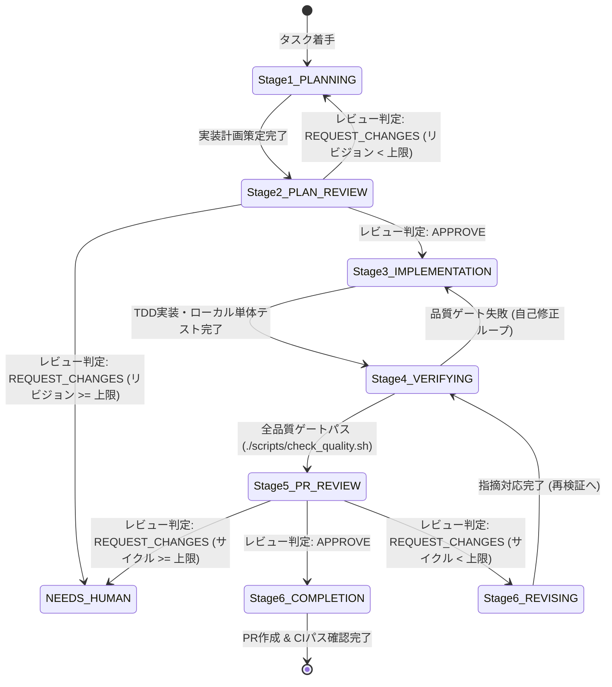

# タスク実行プロンプト

このリポジトリでは `prompt/PLAN.md` と `prompt/SPEC.md` を参照しながら、AIキャッシュ制御型ベクターDB「Pyrope」を実装します。
開発プロセスは手戻りを防ぎ、仕様整合性と安全性を担保するため、**6ステージ実装フロー（Multi-Stage Autonomous Workflow）** に基づいて進めます。

---

## プロジェクト構造

```
Pyrope/
├── src/                          # ソースコード
│   ├── Pyrope.GarnetServer/      # C# Garnetサーバー（フロントエンド / Fast Path）
│   ├── Pyrope.Benchmarks/        # ベンチマークCLI
│   └── Pyrope.AISidecar/         # Python AIサイドカー（Warm Path / gRPC）
├── tests/                        # テストコード
│   ├── Pyrope.GarnetServer.Tests/# C# xUnitテスト
│   └── smoke_test.py             # Redisクライアント smoke test
├── scripts/                      # ユーティリティスクリプト
│   ├── check_quality.sh          # 品質チェック（ビルド・テスト・lint・format）
│   ├── bench_vectors.sh          # ベンチマーク実行スクリプト
│   └── generate_mtls_certs.sh    # mTLS証明書生成スクリプト
├── prompt/                       # AI向けドキュメント
│   ├── PROMPT.md                 # 本ファイル（実装ガイドライン・6ステージワークフロー）
│   ├── PLAN.md                   # 実装ロードマップ・進捗管理
│   └── SPEC.md                   # 完全機能仕様書
└── docker-compose.yml            # 開発・mTLS検証環境
```

---

## 6ステージ実装フロー（Multi-Stage Workflow）

すべてのタスク（新機能、バグ修正、リファクタリング、性能改善）は以下の6ステージを経て進めます。
設計計画とコード差分について独立したレビューゲートを設けることで、仕様齟齬や潜在的な不具合、セキュリティリスクを未然に防ぎます。



---

### Stage 1: PLANNING（実装仕様検討・計画策定）

- **目的**: 仕様・設計・影響範囲を分析し、コードを書く前に堅牢な実装計画を策定する。
- **ワークスペース**: 読み取り中心（コード変更・コミットは行わない）。
- **実施手順**:
  1. **Source of Truth の確認**:
     - `prompt/PLAN.md` で現在のフェーズ・タスク進捗を確認。
     - `prompt/SPEC.md` で機能仕様・制約条件を確認。
     - 既存の関連コード・テスト・Proto定義を読み、設計パターンや契約を理解。
  2. **設計・方針の検討**:
     - アーキテクチャ・インターフェース設計（RESPコマンド、gRPC Proto、クラス責務）。
     - 影響範囲（GarnetServer, AISidecar, テスト, ベンチマーク, 設定）の特定。
     - テスト戦略の策定（Red先行の失敗テスト、Unit / Integration / E2E）。
     - セキュリティ・安全性検討（シークレット漏洩防止、mTLS、入力境界バリデーション）。
  3. **実装計画の作成**:
     - 計画メモや `.ai/plans/<task-name>.md` に計画を言語化（背景、設計方針、変更対象ファイル、テスト手順、段階的タスクリスト）。
     - 設計判断に迷う点や仕様の矛盾があれば、推測で進めずユーザーに確認する。
- **ゲート**: 実装計画が具体化され、Stage 2（PLAN_REVIEW）へ提示可能な状態になっていること。

---

### Stage 2: PLAN_REVIEW（実装仕様レビュー）

- **目的**: 実装前に独立した客観的視点で計画を精査し、手戻り・破壊的変更・設計欠陥を排除する（**自己レビュー禁止**）。
- **ワークスペース**: 読み取り専用。
- **サブエージェントの必須利用**:
  - メインエージェント自身で承認判断を行わず、**必ず独立したサブエージェント（`invoke_subagent`）を起動してレビューを委譲**する。
  - サブエージェント設定例: `Role: 'Plan Reviewer'`, `TypeName: 'research'` または `'self'`
  - サブエージェントに渡すプロンプトに以下を含める:
    - 実装計画書（またはメモ）の内容
    - 参照すべき仕様（`prompt/SPEC.md`, `prompt/PLAN.md`）
    - レビュー観点と判定フォーマット
- **レビュー観点**:
  - **仕様適合性**: `prompt/SPEC.md` の要件・不変条件を満たしているか？
  - **後方互換性と契約**: 既存のRESPコマンド仕様、gRPC Proto後方互換性、mTLS設定に破壊的変更はないか？
  - **セキュリティ**: シークレットの露出リスク、未検証入力の混入、権限昇格リスクはないか？
  - **テスタビリティ**: Redとなるテストケースが十分に検討されているか？
  - **スコープ適正**: 余計な変更や過剰なリファクタリングが含まれていないか？
- **判定フォーマット**:
  - レビュアーサブエージェントは厳格な判定を出力する:
    ```markdown
    ## Plan Review Result
    - **Verdict**: APPROVE | REQUEST_CHANGES
    - **Summary**: <要約>
    - **Findings**:
      - <指摘点1>
      - <指摘点2>
    ```
  - `APPROVE`: Stage 3（IMPLEMENTATION）へ進む。
  - `REQUEST_CHANGES`: 指摘事項を整理して Stage 1（PLANNING）へ戻し、計画を改定（最大リビジョン数: 3回、超過時は `NEEDS_HUMAN` として人間に相談）。

---

### Stage 3: IMPLEMENTATION（TDD実装）

- **目的**: 承認された実装計画に沿って、TDD（テスト駆動開発）サイクルで高品質なコードを実装する。
- **ワークスペース**: 読み書き（作業ブランチ上）。
- **実施手順**:
  1. **作業ブランチの作成**:
     - `main` から `feature/<トピック>` 形式で作成（既存作業ブランチがある場合はそれを継続）。
     ```bash
     git checkout -b feature/<トピック>
     ```
  2. **TDDサイクル（Red → Green → Refactor）**:
     - **Red**: 受け入れ条件を検証する失敗するテストを先に追加する。
     - **Green**: テストをパスさせる最小限の実装を行う。
     - **Refactor**: 設計、可読性、重複排除を改善する（テストがGreenのまま保たれることを確認）。
  3. **Proto/コード生成の同期**:
     - `src/Protos/` を変更した場合は `python codegen.py` でPython側コードを再生成する。
- **ゲート**: 新規・修正したテストがローカルでパスしていること。

---

### Stage 4: VERIFYING（検証・ローカル品質ゲート）

- **目的**: リポジトリ全体の品質ゲート（静的解析・全テスト・フォーマット）を機械的に完走させる。
- **実施コマンド**:
  ```bash
  # 1. C# フォーマット自動修正
  dotnet format Pyrope.sln

  # 2. 全体品質チェック（C#ビルド・テスト、Python lint・テスト、フォーマット検証）
  ./scripts/check_quality.sh
  ```
- **ゲート**: `./scripts/check_quality.sh` がエラーなし（Exit code 0）で100%成功すること。
- **自己修正ループ**:
  - 失敗した場合は、エラーログを分析し、ユーザーにエスカレーションする前に**自己修正**を試みる（Stage 3へ戻る）。

---

### Stage 5: PR_REVIEW（差分レビュー・コード検証）

- **目的**: マージ対象ブランチ（`origin/main`）に対する差分全体（Diff）を独立した観点で厳格にレビューする（**自己レビュー禁止**）。
- **ワークスペース**: 読み取り専用。
- **サブエージェントの必須利用**:
  - 実装を行ったメインエージェント自身で差分を自己承認せず、**必ず独立したサブエージェント（`invoke_subagent`）を起動してコードレビューを委譲**する。
  - サブエージェント設定例: `Role: 'Code Reviewer'`, `TypeName: 'research'` または `'self'`
  - サブエージェントに渡すプロンプトに以下を含める:
    - 差分確認コマンド: `git diff origin/main...HEAD`
    - 承認された実装計画（Stage 1/2）
    - レビュー観点と判定フォーマット
- **レビュー観点**:
  - **計画との整合**: Stage 1〜2で承認された計画通りに実装されているか？
  - **コード品質**: 命名規則（C# `PascalCase`, Python `snake_case`）、可読性、不要なデバッグログ・コメントアウトの残存がないか？
  - **ドキュメント整合**: `prompt/PLAN.md` の進捗状況や `prompt/SPEC.md`、`README.md` との整合性が保たれているか？
  - **不純物の混入防止**: バイナリ、一時ファイル、`coverage/` ディレクトリ、環境依存ファイルが含まれていないか？
  - **セキュリティ**: APIキーやシークレットのハードコード、不安全な入力処理がないか？
- **判定フォーマット**:
  - レビュアーサブエージェントは厳格な判定を出力する:
    ```markdown
    ## PR Review Result
    - **Verdict**: APPROVE | REQUEST_CHANGES
    - **Summary**: <レビュー要約>
    - **Findings**:
      - <指摘点1>
      - <指摘点2>
    ```
  - `APPROVE`: Stage 6（COMPLETION）へ進む。
  - `REQUEST_CHANGES`: Stage 6（REVISING）へ進み、指摘事項の修正を行う。

---

### Stage 6: REVISING & PR_COMPLETION（リビジョン & PR作成・完了ゲート）

- **目的**: レビュー指摘事項の修正、ドキュメントの最終更新、PR作成、CIステータスの確認。
- **実施手順**:
  - **REVISING（修正が必要な場合）**:
    1. レビュー指摘事項を修正する。
    2. Stage 4（VERIFYING: `./scripts/check_quality.sh`）を再実行してパスすることを確認する。
    3. Stage 5（PR_REVIEW）で再レビューを受ける（最大サイクル数: 3回、超過時は人間に相談）。
  - **PR_COMPLETION（承認された場合）**:
    1. **`prompt/PLAN.md` の更新**:
       - 完了したタスクのチェックボックスを更新（`[ ]` → `[x]`）。
       - `Current:` や `Tests:` セクションに今回の成果・テスト結果の要約を記載。
    2. **コミット & プッシュ**:
       - Conventional Commits プレフィックス（`feat:`, `fix:`, `docs:`, `test:`, `refactor:`, `perf:`, `chore:`）を使用。
       ```bash
       git status --short
       git add <対象ファイル>
       git commit -m "<type>: <簡潔な説明>"
       git push -u origin feature/<トピック>
       ```
    3. **Pull Request 作成**:
       ```bash
       gh pr create --title "<タスク名>" --body "<変更内容、テスト結果、レビュー確認事項>"
       ```
    4. **CIステータスの確認**:
       ```bash
       gh pr checks       # PRのCI結果を確認
       gh run list        # ワークフロー実行一覧
       gh run view <run-id> --log   # 失敗時のログ詳細
       ```
- **ゲート**: PRが作成され、GitHub Actions CIがすべてGreenでパスすること。

---

## AI Agent Guidelines（AIアシスタント向け運用規則）

コード変更や開発を行う際は、以下のルールを厳格に遵守してください。

### 役割分担とサブエージェントの必須活用（客観性の担保）
- **自己レビューの完全禁止**: レビュー段階（Stage 2: PLAN_REVIEW, Stage 5: PR_REVIEW）では、計画やコードを執筆したメインエージェント自身で承認判定を行わず、**必ず独立したサブエージェント（`invoke_subagent`）を起動して客観的なレビュー（`APPROVE` / `REQUEST_CHANGES`）を実施**すること。
- **推測の排除**: 仕様に曖昧さがある場合や既存契約に反する疑いがある場合は、推測で進めず立ち止まって確認・エスカレーションする。

### コンテキスト同期
1. **PLAN.md を常に更新**: タスク着手時と完了時に必ず更新し、リポジトリの状態と整合させる。
2. **SPEC.md を遵守**: 仕様変更が必要な場合はコード修正前にドキュメントの更新提案を行う。

### 自己修正ループと上限管理
- テストやLint、ビルドが失敗した場合は、エラーログから根本原因を特定し自律的に修正する。
- 無限ループを防ぐため、計画リビジョンおよびPR修正サイクルはそれぞれ最大3回とし、解決しない場合は理由と再現手順を整理してユーザーに報告する。

---

## よく使うコマンド

### ビルド & 品質チェック
```bash
# 全体品質チェック（推奨: C#フォーマット、ビルド、テスト、Python lint・テスト）
dotnet format Pyrope.sln
./scripts/check_quality.sh

# C# テストのみ
dotnet test Pyrope.sln

# 個別C#プロジェクトのテスト
dotnet test tests/Pyrope.GarnetServer.Tests/Pyrope.GarnetServer.Tests.csproj

# Python サイドカーテスト
python3 -m unittest discover -s src/Pyrope.AISidecar/tests -p "test_*.py"
```

### Git & GitHub
```bash
# ブランチ作成
git checkout -b feature/<トピック>

# 差分確認（PR_REVIEW用）
git diff origin/main...HEAD

# PRの作成
gh pr create --title "<タスク名>" --body "<概要とテスト結果>"

# CI状況確認
gh pr checks
gh run list
gh run view <run-id> --log
```

### Docker & 環境
```bash
docker-compose up -d      # 開発・mTLS環境起動
docker-compose down       # 停止
docker-compose logs -f    # ログ確認
```

---

## トラブルシューティング

### レビュー差し戻し（REQUEST_CHANGES）が続く場合
1. 指摘事項の根本原因（仕様理解不足、考慮漏れの境界条件、アーキテクチャの不整合）を整理する。
2. 3回以上のリビジョンループが発生した場合は、自己判断を繰り返さず人間に相談（NEEDS_HUMAN）する。

### CI / 品質チェック失敗時
1. `gh run view <run-id> --log` または `./scripts/check_quality.sh` で失敗ログを確認。
2. 失敗箇所（ビルド、フォーマット、C#テスト、Python lint/テスト）を特定。
3. 最小限の修正でテストを通し、既存機能への影響がないか再検証。

### ビルドエラー時
1. エラーメッセージから依存関係・Proto生成・コード記述のいずれに起因するかを切り分け。
2. `dotnet restore` または `pip install -r src/Pyrope.AISidecar/requirements.txt` を試す。
3. Proto定義変更時は `src/Pyrope.AISidecar/codegen.py` を実行して同期。

---

## チェックリスト（完了ゲート）

PR作成前に、全ステージの要件を満たしているか確認してください。

- [ ] **Stage 1 (PLANNING)**: `PLAN.md` / `SPEC.md` を確認し、設計方針とテスト計画を立てた
- [ ] **Stage 2 (PLAN_REVIEW)**: 独立したサブエージェント（`invoke_subagent`）によるレビューを受け、設計の互換性・安全性・テスタビリティで `APPROVE` を得た
- [ ] **Stage 3 (IMPLEMENTATION)**: `feature/<トピック>` ブランチ上で TDD（Red → Green → Refactor）に従って実装した
- [ ] **Stage 4 (VERIFYING)**: `dotnet format` を実行し、`./scripts/check_quality.sh` が100%パスした
- [ ] **Stage 5 (PR_REVIEW)**: 独立したサブエージェント（`invoke_subagent`）による差分レビューを受け、不要なコードや不純物がないこと・品質要件で `APPROVE` を得た
- [ ] **Stage 6 (COMPLETION)**: `prompt/PLAN.md` を更新し、適切なコミットメッセージでプッシュ、PRを作成した
- [ ] **CI Verification**: GitHub Actions CIの checks がすべて Green になった
